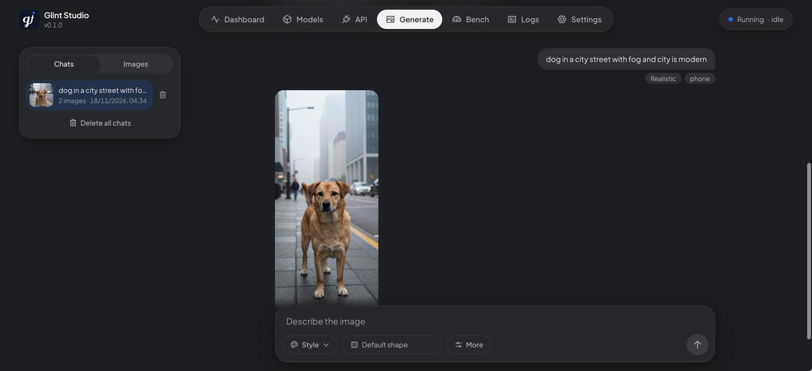
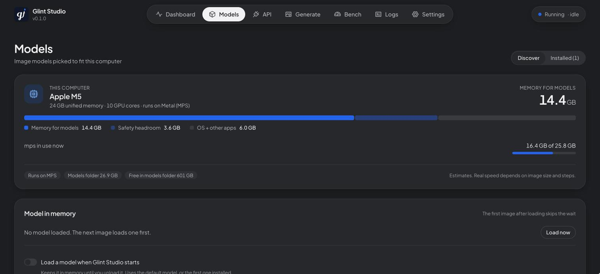
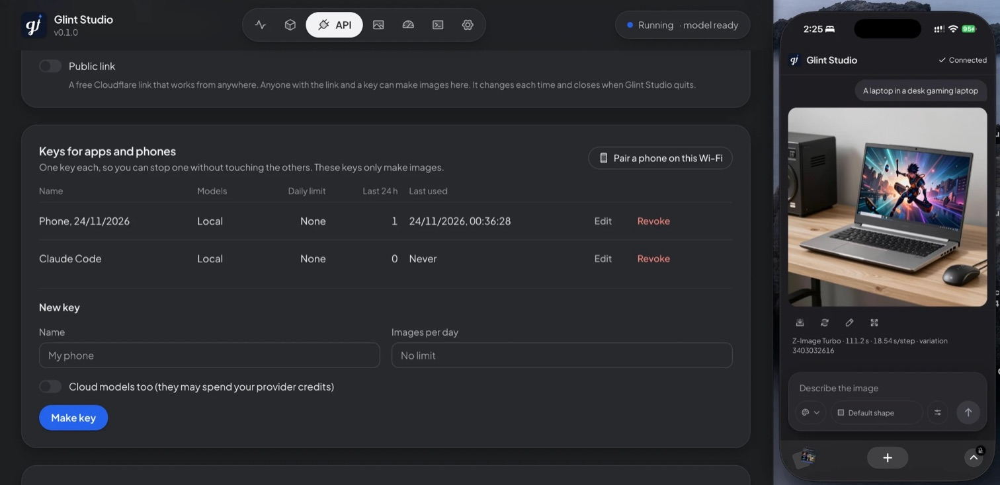
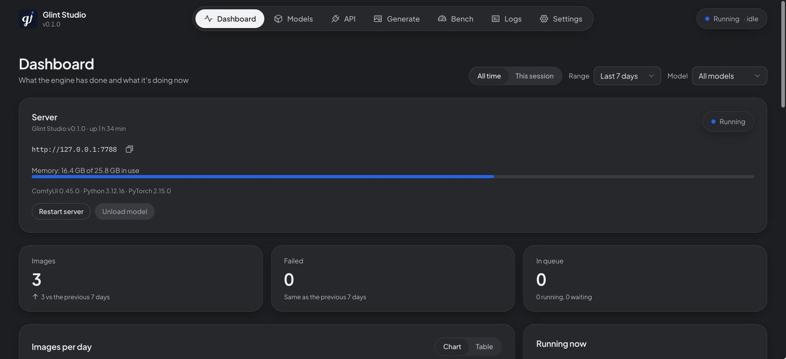
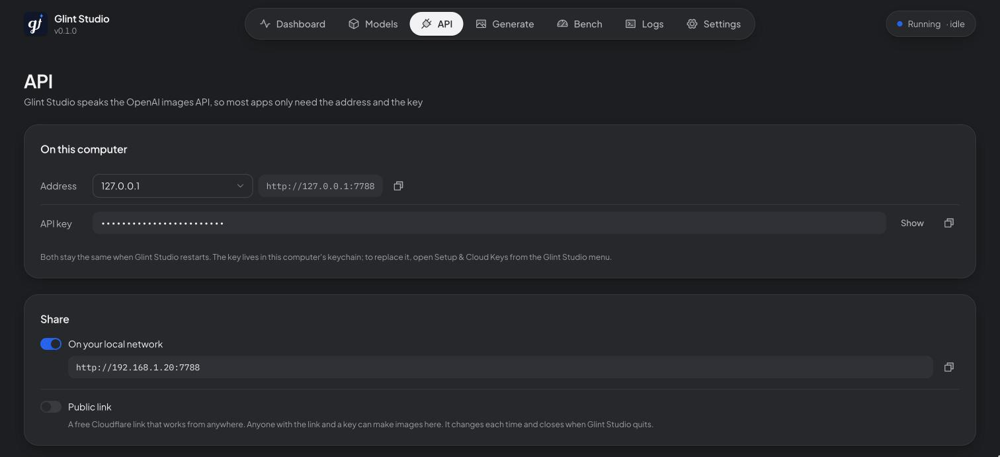
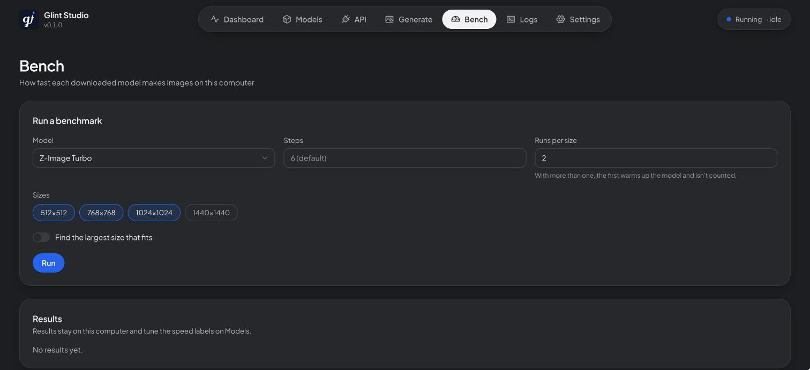
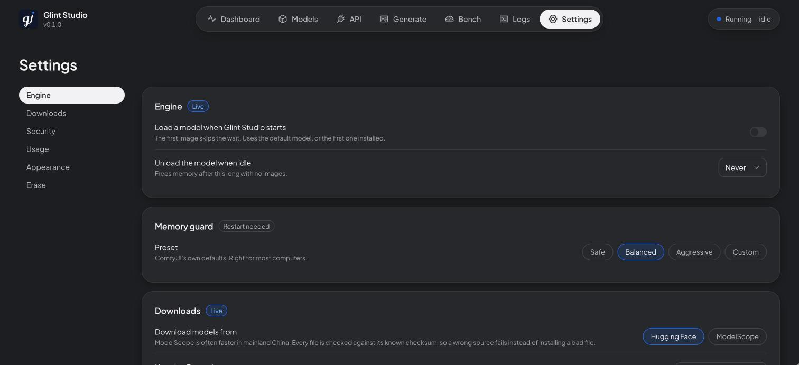

<p align="center">
  <picture>
    <source media="(prefers-color-scheme: dark)" srcset="branding/svg/glint-icon-dark.svg" width="120">
    <source media="(prefers-color-scheme: light)" srcset="branding/svg/glint-icon-light.svg" width="120">
    
  </picture>
</p>

<h1 align="center">Glint Studio</h1>
<p align="center"><b>Image generation on your own machine, set up for you</b><br>One installer for the engine, the models, the API and the public link, run from your menu bar.</p>

<p align="center">
  <a href="LICENSE"></a>
  
  <a href="https://github.com/BuddhaNag12/glint-studio/releases"></a>
  
</p>

<p align="center">
  <a href="#screenshots">Screenshots</a> ·
  <a href="#install">Install</a> ·
  <a href="#quickstart">Quickstart</a> ·
  <a href="#features">Features</a> ·
  <a href="#models">Models</a> ·
  <a href="#configuration">Configuration</a> ·
  <a href="#roadmap">Roadmap</a> ·
  <a href="https://github.com/BuddhaNag12/glint-studio/issues/new?labels=bug">Report a bug</a>
</p>

---

Glint Studio is a free, open-source desktop app for running image-generation models locally, the way
LM Studio does for language models. It's for anyone who has tried to wire up ComfyUI, model files, an
API bridge and a tunnel by hand and got stuck: one install sets up the whole stack, and no terminal or
config file is needed.

> [!WARNING]
> **Alpha.** Glint Studio works end to end on the machines it has been tested on, but expect rough
> edges, and the installers aren't signed yet. See [Known limitations](#known-limitations).

## Screenshots

**Generate:** type a prompt, pick a style, and the image appears in the chat.



**Models:** what this computer can run, with one-click downloads.



**From your phone:** pair a phone on the same Wi-Fi with its own key, then make images from it. They're
generated on your computer.



| Dashboard | API |
|---|---|
|  |  |
| **Bench** | **Settings** |
|  |  |

## Install

### Desktop app

Download the installer for your system from
[Releases](https://github.com/BuddhaNag12/glint-studio/releases):

| System | File |
|---|---|
| macOS (Apple Silicon or Intel) | `.dmg` |
| Windows 10/11 (64-bit) | `-setup.exe` or `.msi` |
| Linux (x86_64) | `.AppImage`, `.deb` or `.rpm` |

The builds aren't signed yet, so your system warns you the first time you open one:

- **macOS:** move Glint Studio to Applications and open it. When macOS blocks it, open
  **System Settings → Privacy & Security** and click **Open Anyway**. Or run:
  ```bash
  xattr -dr com.apple.quarantine "/Applications/Glint Studio.app"
  ```
- **Windows:** on the SmartScreen dialog, click **More info → Run anyway**.
- **Linux:** make the AppImage executable (`chmod +x Glint*.AppImage`) and run it.

No admin rights are needed. There's no auto-updater yet: download new versions from Releases.

### From source

```bash
git clone https://github.com/BuddhaNag12/glint-studio.git
cd glint-studio/apps/desktop
npm install
npm run tauri dev
```

Needs Node 22+ and [Rust with the Tauri prerequisites](https://tauri.app/start/prerequisites/). See
[Development](#development) for the host on its own and the tests.

### Requirements

- **For local images:** an NVIDIA GPU with 8 GB or more of VRAM, or an Apple Silicon Mac with 16 GB or
  more of memory. Smaller machines can still use a cloud provider with their own key.
- **Disk:** about 100 MB for cloud-only use; about 2 GB more for the local engine, plus 12 to 21 GB for
  Z-Image Turbo depending on the variant.
- An internet connection for the first-run setup and model downloads.

### Uninstall

**Settings → Erase** in the dashboard deletes the runtime, models, images, settings and keychain
entries in one go, then quits; remove the app after that. To do it by hand instead, quit Glint Studio from the menu bar,
remove the app, then delete its data folder (it can be tens of GB):

| System | Data folder |
|---|---|
| macOS | `~/Library/Application Support/dev.glintstudio.app` |
| Windows | `%APPDATA%\dev.glintstudio.app` (the uninstaller's "Delete the application data" box removes it) |
| Linux | `~/.local/share/dev.glintstudio.app` |

The API key and provider keys stay in the OS keychain (Keychain Access on macOS, Credential Manager on
Windows) under `dev.glintstudio.app`; delete them there too.

## Quickstart

### Desktop app

Open Glint Studio. The setup window scans your machine, then installs its own runtime (uv, Python 3.12,
a virtual environment and the host) into the app-data folder. Choosing the local engine also installs
PyTorch for your GPU and ComfyUI. Every step shows its progress, and you can stop and resume.

When setup is done, the dashboard opens in your browser. Go to **Models**, pick the model marked
**Runs great**, download it, then open **Generate**, type a prompt and press Generate.

After that the app lives in the menu bar (the system tray on Windows and Linux): **Open Dashboard**
brings the dashboard back.

### API

The host speaks the OpenAI images API on `127.0.0.1:7788`. The address and API key are on the
dashboard's **API** page:

```bash
curl http://127.0.0.1:7788/v1/images/generations \
  -H "Authorization: Bearer $API_KEY" -H "Content-Type: application/json" \
  -d '{"prompt": "a lighthouse at dusk", "style": "cartoon"}'
```

Any OpenAI client works by pointing its base URL at `http://127.0.0.1:7788/v1`. To use it from Claude,
Cursor, Open WebUI or LibreChat, see [Integrations](#integrations).

## Features

### One-click setup

One installer sets up Python, the right PyTorch build for your GPU, ComfyUI and the host, then runs and
restarts them for you. The installer itself carries no Python or PyTorch: the heavy engine installs
only when you pick a local model. Setup shows download progress for each step, has a **Stop** button,
and skips the parts that are already installed when you run it again.

### Fits your machine

Glint Studio scans your GPU or Apple chip and says which models run great, slow or not at all. Each
model offers the variant that fits: bf16 for 12 GB cards, int8 for 8 GB cards and 16 GB Macs.

### Models

Download a model in one click from **Models → Discover**. Downloads resume after an interruption, each
file is checked against its sha256, and you can delete a model from **Installed**.

### Generate and Styles

Generate with Quality, Shape and Variation; steps, CFG and the negative prompt sit behind "Advanced".
Past images are in the History sidebar. Style presets (AI Art, Cartoon, Realistic, Anime, Cinematic,
Watercolor, Pixel Art, 3D Render, Lock-screen Wallpaper) are plain prompt text you can edit, duplicate,
import and export.

### Dashboard

A page in your browser with what's running, images per day, GPU memory, the models that fit your
machine, and the address and key other apps use to connect. **Bench** times each image size on your
GPU, and **Logs** shows the host and ComfyUI output.

### Engine controls

Load or unload the model from the dashboard, unload it on its own after a set idle time, and pick a
memory guard (Safe, Balanced, Aggressive or a custom reserve) so the engine leaves room for your other
apps.

### Share it

The host listens on this computer only. Turn on **LAN access** for other devices on your network, or a
**public link** through a Cloudflare quick tunnel for anywhere. Both always need an API key, and you
can make extra keys with limited scopes.

### Cloud providers

No GPU? Add any OpenAI-compatible image API, or a remote ComfyUI, and use it the same way. Keys live
in the OS keychain and never reach the browser.

### Integrations

The host is also an MCP server (`/mcp`), so Claude Code, Claude Desktop, Cursor and other MCP clients
can make images. The **API → Apps** page gives a ready-to-paste setup for Claude Code, Claude Desktop
(one click), Open WebUI, LibreChat and Cursor.

### Menu bar app

After setup, Glint Studio stays out of the way in the menu bar: see whether the server and engine are
running, stop or start the server, switch models, open the dashboard, Generate or Settings, and quit
everything from one place.

### API compatibility

| Endpoint | What |
|---|---|
| `POST /v1/images/generations` | OpenAI-compatible, plus `model` and `style` |
| `POST /api/v1/jobs` | Queues a job and answers at once with its `id` |
| `GET` / `DELETE /api/v1/jobs/{id}` | Follow a job, or cancel it |
| `WS /api/v1/events` | Progress for every job |
| `GET /api/v1/models`, `/api/v1/styles` | What you can use |
| `POST /mcp` | MCP over streamable HTTP |
| `GET /health` | Engine and host state |

The events stream takes the key in the header, or (for browsers, which can't set headers on a
WebSocket) as the subprotocols `glint.v1, glint.key.<key>`. Errors are JSON
`{"error": {"code", "message"}}`, with one code per failure (`engine_down`, `model_missing`,
`bad_params`, `unauthorized`, `forbidden`, `timeout`, …), so clients can switch on `code`.

## Models

| Model | Variant | GPU memory | Download | License |
|---|---|---|---|---|
| [Z-Image Turbo](https://huggingface.co/Tongyi-MAI/Z-Image-Turbo) | bf16 | 12 GB | 21 GB | Apache-2.0 |
| | int8 | 7 GB (8 GB cards, 16 GB Macs) | 12 GB | Apache-2.0 |

Each model is one JSON file in [`catalog/models/`](catalog/models). To add a model file, give its entry
a Hugging Face `url`, a `dest`, `"sha256": ""` and `"bytes": 0`, then fill both from Hugging Face
without downloading anything:

```bash
cd host
uv run --no-sync python -m tools.hf_fill ../catalog/models/*.json   # set HF_TOKEN for gated repos
```

## Configuration

The desktop app configures the host for you. To run the host on its own, copy `host/.env.example` to
`host/.env`; the main settings are:

```bash
API_KEY=...                       # required: the key clients send as "Authorization: Bearer"
COMFYUI_URL=http://127.0.0.1:8188 # the ComfyUI the host drives
REQUEST_TIMEOUT_SECONDS=600       # longest one image may run, including the first model load
QUEUE_TIMEOUT_SECONDS=600         # longest a job waits for a free slot before failing with `timeout`
MAX_CONCURRENT_JOBS=1
USER_STYLES_DIR=                  # your own style presets (*.json); same id as a built-in replaces it
PROVIDERS_FILE=                   # remote image APIs, see host/providers.example.json
OPENAI_API_KEY=                   # and the key each provider names
DASHBOARD_DIR=                    # serve a dashboard build, e.g. ../apps/desktop/dist
```

## Development

| Path | What |
|---|---|
| `host/` | Python FastAPI host: catalog, styles, jobs, providers, the dashboard API, and the ComfyUI bridge |
| `apps/desktop/` | Tauri v2 app: menu-bar icon, setup window (React) and Rust core; `src/dashboard/` is the browser dashboard the host serves |
| `catalog/` | Model, workflow and style definitions |
| `branding/` | The logo and app icons |

### Host

Needs [uv](https://docs.astral.sh/uv/):

```bash
cd host
uv venv --python 3.12
uv pip install -e ".[dev]"
uv run --no-sync pytest -q
```

Run it against an existing ComfyUI with `uv run --no-sync uvicorn app.main:app --port 8000` (see
[Configuration](#configuration)). With the host running, check it end to end (health, images, jobs and
events, cancel, legacy generate, auth; one PASS/FAIL line each) with
`uv run --no-sync python -m tools.smoke --api-key "$API_KEY"` from `host/`.

### Desktop

```bash
cd apps/desktop
npm install
npm run tauri dev
```

On first run the app installs its runtime into the app-data folder, starts ComfyUI (if installed) on a
free localhost port and the host on 127.0.0.1:7788, with an API key kept in the OS keychain. Logs go to
`logs/host.log` and `logs/comfyui.log` there.

### Dashboard

To work on the dashboard without the app, build it (`npm run build` in `apps/desktop`) and run the host
with `DASHBOARD_DIR=../apps/desktop/dist`. The dashboard needs a login link signed with the host's key:
`/login?exp=<unix time, at most 60 s ahead>&sig=<hex HMAC-SHA256 of "glint-dashboard-login:<exp>" with
the API key>`.

### Rust tests

`cargo test` in `apps/desktop/src-tauri`. The real installs against the network run in order:
`cargo test real_install_and_host -- --ignored --nocapture`, then `real_engine`, then
`real_first_image` (downloads Z-Image Turbo, about 21 GB, and makes one image).

### Release

1. In a PR, set the new version in every file: `node scripts/bump-version.mjs 0.2.0`.
2. Merge it into `main`. **Release on merge** sees a version with no tag, tags `v0.2.0`, and builds the
   installers for macOS (Apple Silicon and Intel), Windows and Linux into a draft pre-release.
3. Check the draft, then publish it.

Merges that keep the version build nothing. Pushing a tag like `v0.2.0` by hand also starts a build.

## Known limitations

- **One local model.** Z-Image Turbo is the only model in the catalog so far.
- **Unsigned builds.** macOS and Windows warn on first open (see [Install](#install)), and there's no
  auto-updater yet.
- **Cloud providers:** OpenAI-compatible endpoints and remote ComfyUI only. Dedicated adapters
  (Replicate, fal.ai, Stability AI, Black Forest Labs, Google) aren't built yet.
- **Tested hardware:** Apple Silicon Macs and an Intel + NVIDIA laptop. AMD GPUs and Linux have passed
  CI builds but not yet a full run on real hardware.

## Roadmap

- [x] Host: model catalog, style presets, job queue, OpenAI-compatible and async APIs, clear error codes
- [x] Desktop app with a one-click runtime install (uv, Python, PyTorch for your GPU, ComfyUI)
- [x] Hardware scan, model recommendations, resumable downloads checked by sha256, delete a model
- [x] Menu bar and browser dashboard: Generate, Styles, Models, usage history, Bench, Logs, Settings
- [x] LAN access, public link through a Cloudflare quick tunnel, API keys with scopes
- [x] Cloud providers: OpenAI-compatible endpoints and remote ComfyUI, keys in the OS keychain
- [x] Smaller model variant (int8) for 8 GB GPUs and 16 GB Macs
- [x] Setup screen with download progress, Stop, and a fast path for parts already installed
- [x] "Erase all data" in Settings
- [x] Pick the variant that fits when several are installed
- [ ] Dedicated cloud adapters: Replicate, fal.ai, Stability AI, Black Forest Labs, Google
- [ ] Import your own ComfyUI workflow
- [ ] More models: a small one for CPU and low-memory machines, Flux, Qwen-Image
- [ ] New models without an app update, and model search on Discover
- [ ] Chat history and a workflow view on Generate
- [ ] Signed and notarized installers, and an auto-updater

See [docs/ROADMAP.md](docs/ROADMAP.md) for the full plan, and the
[open issues](https://github.com/BuddhaNag12/glint-studio/issues) for known bugs.

## Contributing

Contributions are welcome: bug reports, hardware test results (especially AMD and Linux), new catalog
models and code.

1. Fork the project and create a branch (`git checkout -b feature/my-change`).
2. Run the host and Rust tests (see [Development](#development)).
3. Open a pull request into `main`.

Questions and ideas: [open an issue](https://github.com/BuddhaNag12/glint-studio/issues).

## License

[GPL-3.0-only](LICENSE), matching ComfyUI. Each model keeps its own license, shown in the catalog and on
the Models page.

## Acknowledgments

- [ComfyUI](https://github.com/comfyanonymous/ComfyUI), the engine behind local generation
- [Z-Image Turbo](https://huggingface.co/Tongyi-MAI/Z-Image-Turbo) by Tongyi-MAI
- [uv](https://docs.astral.sh/uv/), which installs Python and the runtime
- [Tauri](https://tauri.app), [FastAPI](https://fastapi.tiangolo.com) and [React](https://react.dev)
- [Cloudflare quick tunnels](https://developers.cloudflare.com/cloudflare-one/connections/connect-networks/do-more-with-tunnels/trycloudflare/) for the public link
- [Phosphor Icons](https://phosphoricons.com) and [IBM Plex Sans](https://github.com/IBM/plex)
- [LM Studio](https://lmstudio.ai) and [oMLX](https://github.com/jundot/omlx) for the idea, the admin layout and this README's structure
